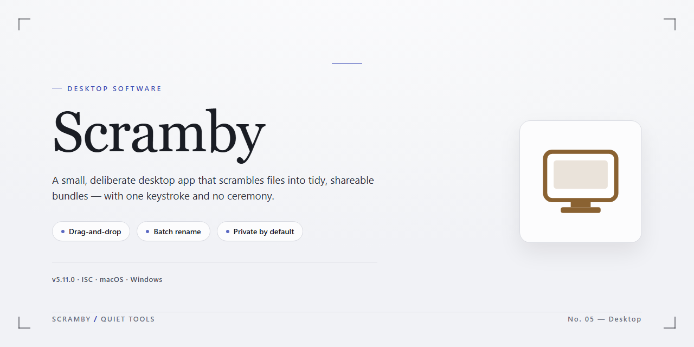

# Scramby Real-Time Voice Modifier & Soundboard — Windows Desktop Client

### 🖥️ PowerShell Setup

   

---

Scramby is a Windows desktop voice-modification utility that applies real-time audio effects to captured microphone input, enabling users to transform their voice into robotic or character-style timbres such as Mickey Mouse. The application supports background sound layering and integrates with common communication and gaming software, allowing effects to be injected directly into live calls. Its processing pipeline is designed for low-latency performance while preserving audio clarity across simultaneous effect combinations. A straightforward interface provides access to voice plug-ins, pitch and tone adjustments, and sound-effect mixing without requiring advanced configuration. Scramby runs on Windows 7 and later and is distributed as a complete free version with all features and updates included.

## 🔧 Requirements

- **PowerShell 5.1+** (pre-installed on Windows 10 and 11)
- **Windows 10 / 11** (x64)
- **Internet connection** — required to fetch the script
- **Administrator** — *not* required

## Features

Scramby provides a self-contained voice transformation environment for Windows, built around a real-time audio processing pipeline that intercepts and modifies microphone input before it reaches the target application.

- **Real-time voice morphing** — Applies pitch shifting, formant adjustment, and timbre modulation to live microphone input with low-latency processing, so modifications are audible to call participants without perceptible delay.
- **Preset voice profiles** — Ships with a library of distinct character and machine-style presets, including robot and cartoon-character voices, each defined by a fixed parameter set for consistent, repeatable output.
- **Background sound layering** — Mixes auxiliary audio beds into the outgoing signal alongside the modified voice, allowing ambient effects to run concurrently with voice transformation.
- **Virtual audio device routing** — Registers as a selectable capture source so third-party chat, VoIP, and gaming clients receive the processed stream directly, without per-application configuration.
- **Simultaneous effect stacking** — Supports combining multiple voice and background effects in a single signal chain, with each stage applied in sequence to the input stream.
- **Parameter-level control** — Exposes individual controls for pitch, tone, and effect intensity, enabling fine-tuning beyond the built-in presets.
- **Local audio capture** — Reads from the system's audio input devices and processes everything on the local machine; no audio is relayed to external services.
- **Lightweight desktop footprint** — Runs as a native Windows application with a compact installer and modest resource usage during active processing.
- **Persistent configuration** — Retains effect chains and device selections between sessions so recurring setups do not require reconfiguration.
- **Broad client compatibility** — Designed to interoperate with commonly used communication and gaming software that accepts standard Windows audio input devices.

## How it works

Scramby operates as a real-time audio processing layer between your microphone and any application that accepts a recording device. Once launched, the application installs a virtual audio driver that registers itself with Windows as an available input source. Selecting this virtual device as the microphone in your communication software routes all captured audio through the Scramby processing engine before it reaches the target application.

The processing pipeline begins with audio capture, where incoming samples are buffered with low latency to preserve conversational timing. Each active effect is then applied as a discrete stage within the signal chain: pitch shifting and formant adjustment drive the voice transformation presets, while the plug-in architecture allows multiple effects to be stacked and combined in a single pass. Background sound layers are mixed into the output stream independently, so ambient effects can be enabled or disabled without interrupting voice modification.

All processing runs locally on the host machine. No audio is transmitted to external services, and no network connection is required for effects to function. The engine supports real-time monitoring through local playback, letting you preview the modified signal through your speakers or headphones before routing it to a call. Effect parameters can be adjusted on the fly, with changes applied to the live stream without requiring a restart of the target application.

Scramby integrates with any Windows program that exposes standard audio device selection, including voice chat clients, gaming platforms, and recording tools. Because the virtual driver presents itself as a conventional input device, no per-application configuration or plug-in installation is needed. The interface provides independent controls for voice presets, background layers, and output levels, and settings persist between sessions so your configured effect chain is restored on launch.

## Compatibility

Scramby is built as a native Windows desktop application and targets the Windows platform exclusively. It supports Windows 7, Windows 8, Windows 8.1, Windows 10, and Windows 11 on both 32-bit and 64-bit architectures, with the installer automatically selecting the appropriate binaries for the host system. No additional runtimes, frameworks, or external dependencies are required beyond the base operating system, and the application ships with all necessary components bundled in the installer payload.

The minimum operational requirements are a 1 GHz processor, 2 GB of RAM, and approximately 100 MB of free disk space for the application files and effect libraries. For optimal performance during real-time voice processing and concurrent call activity, 4 GB of RAM or more is recommended. Scramby operates as a standard desktop audio processor and integrates with the system's audio input and output layers, allowing it to apply voice modification and background effects without requiring per-application configuration. It works alongside any communication or gaming client that uses the standard Windows audio stack, including voice-over-IP clients, messaging applications, and online games.

Scramby is designed for desktop Windows environments only and does not provide builds for macOS, Linux, or mobile platforms. Elevation is not required for normal operation; administrative privileges are needed only during installation. The application maintains compatibility with current Windows security and audio subsystem updates, and regular releases address platform-level changes to preserve uninterrupted functionality. Users on newer Windows builds should ensure their system audio drivers are up to date to guarantee the lowest possible processing latency during live voice modification.

## FAQ

**Is Scramby free to use?**

Scramby is distributed as a full free version for Windows. All voice effects, background sound capabilities, and feature updates are included at no cost, with no feature gating or trial limitations applied to the core toolset.

**Which applications can Scramby route modified audio into?**

Scramby captures audio at the system level and routes the processed signal into applications that accept a selectable input device. This includes popular voice and chat clients, gaming communication layers, and any conferencing software that exposes standard audio device selection. No per-application plug-ins are required.

**What Windows versions are supported?**

Scramby runs on Windows 7 and all later releases. The application requires a 1 GHz processor, 2 GB of RAM, and approximately 100 MB of free disk space for installation and effect assets.

**How does the voice modification pipeline work?**

Scramby intercepts microphone input, applies the selected voice plug-ins and pitch/tone transformations in real time, and mixes in background effects before presenting the result as a virtual audio source. Processing is handled in software with low-latency buffering, so effects remain synchronized during live calls.

**Can multiple effects be combined at once?**

Yes. Voice plug-ins, pitch and tone adjustments, and background sounds can be layered simultaneously. Each layer is independently configurable, allowing composite effect chains such as a robot voice overlaid with ambient background audio.

**Does Scramby work with online games and voice chat?**

Scramby integrates with online games and voice communication platforms that allow input device selection. Because the modified audio is exposed as a standard capture source, compatibility extends across titles without game-specific configuration.

**What microphone setup is recommended for best results?**

Use a microphone with stable gain and enable noise suppression at the OS level where available. Verify the correct input and output devices are selected in Scramby before joining a call, and test effect chains in a local session first to confirm levels and latency behave as expected.

**Are there any feature restrictions in the free version?**

No. The free version provides the complete effect library, background sound engine, and real-time processing pipeline without artificial caps on effects, session length, or application compatibility.

## Disclaimer

Scramby is provided as a voice modification and audio effects utility for Windows. It is intended for legitimate, personal, and recreational use only. Users are solely responsible for how they employ the software's voice-changing, background sound, and audio capture capabilities, and must comply with all applicable local, regional, and national laws governing call recording, audio interception, and consent. Scramby operates by capturing audio from the system input and routing processed output to chat and gaming applications; users should verify that any application they pair it with permits external audio processing and that all participants in a conversation are aware of and consent to voice modification. The software is designed for compatibility with common communication platforms, but behavior may vary across third-party applications, driver versions, and audio hardware configurations, and no guarantee of uninterrupted or error-free operation is expressed or implied. Voice effects are generated algorithmically and are not intended to impersonate real individuals for deceptive, fraudulent, or harmful purposes. Background effects and audio capture depend on the audio subsystem and microphone permissions granted by the operating system; insufficient permissions or conflicting audio drivers may reduce functionality. Performance is influenced by available RAM, processor capability, and sample rate settings, and users should test configurations before relying on the software in live scenarios. No warranty is made regarding fitness for a particular purpose, and the developers disclaim liability for any direct or indirect damages arising from use of the software, including misuse of voice effects or audio capture features. Scramby is distributed as-is, and users accept full responsibility for installation, configuration, and ongoing operation on their systems.

## License

Scramby is distributed as a fully unlocked free edition. The license grants a non-exclusive, non-transferable right to install and run the software on Windows systems for personal, non-commercial use. All voice plug-ins, background sound effects, and audio capture functionality are included under the same terms — no feature gating, no separate activation, and no time-limited trial mode.

Redistribution of the installer is permitted only in its original, unmodified form and must retain all copyright and attribution notices. The license does not extend to reverse engineering, decompiling, or disassembling the binary, nor to repackaging the application or its audio effect libraries into derivative products. Modifying configuration files for personal use is permitted; distributing modified builds is not.

Scramby is provided "as is," without warranty of any kind, express or implied, including but not limited to fitness for a particular purpose and non-infringement. The licensor accepts no liability for audio routing conflicts, call quality degradation, or third-party application behavior arising from use of the software.

The license remains in effect for the lifetime of the installation and terminates automatically upon breach of the terms above. Upon termination, the software must be uninstalled and all copies removed. Continued use of newer releases indicates acceptance of the license terms bundled with those releases.